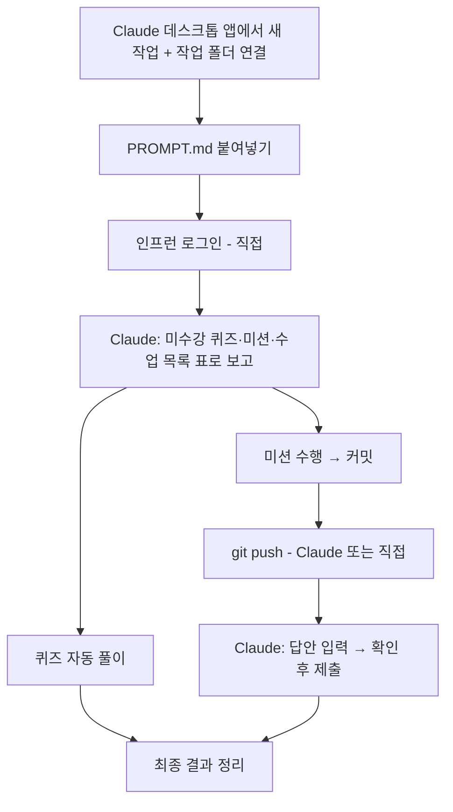
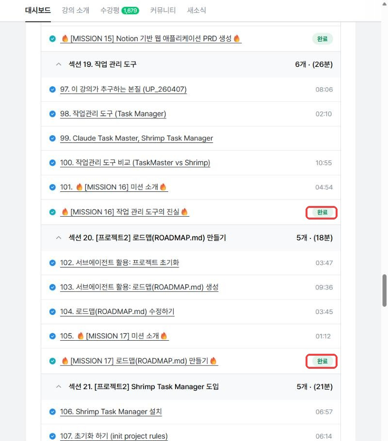
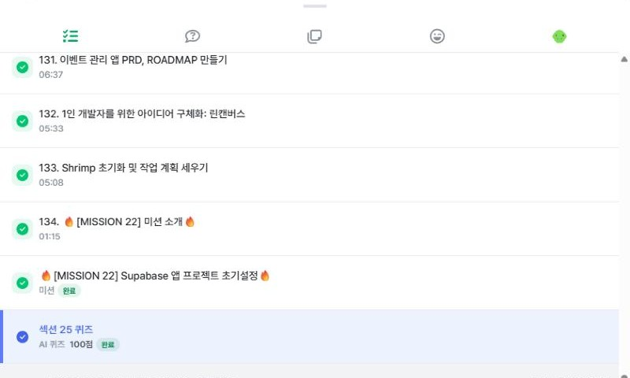
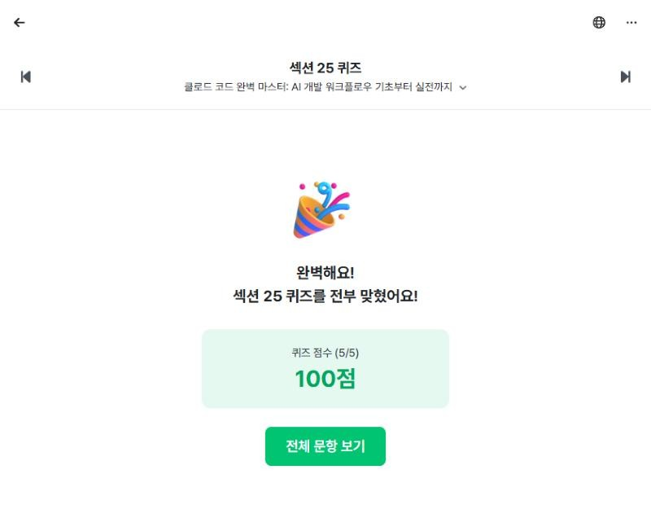
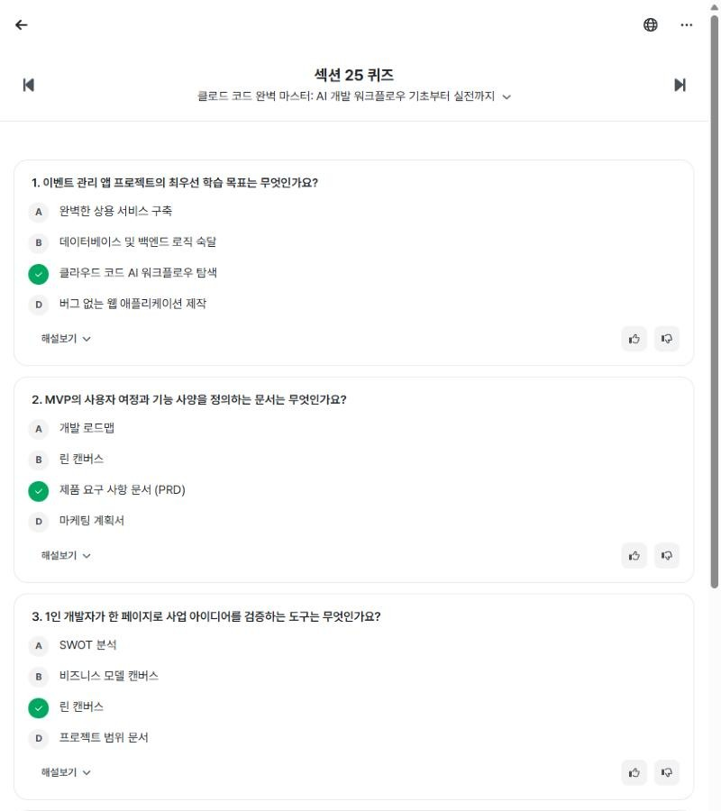
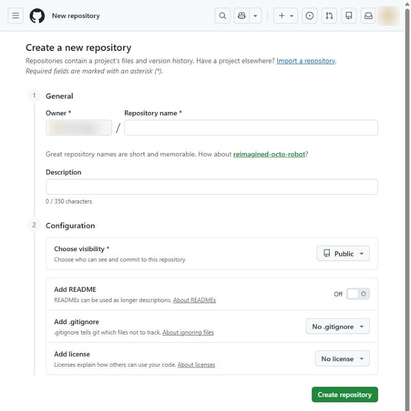
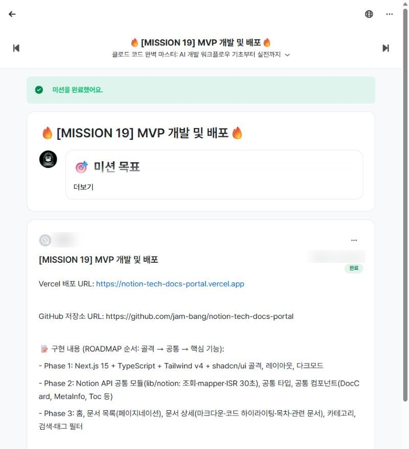
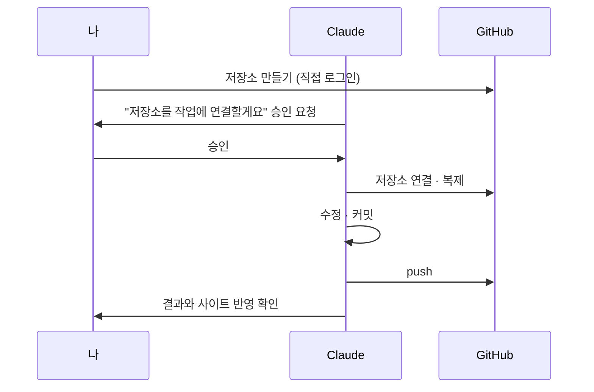

# 인프런 강의 미수강 항목, Claude에게 맡기기

인프런(비즈니스) 강의에서 **풀지 않은 퀴즈, 제출하지 않은 미션, 수강하지 않은 수업**을 Claude가 찾아 처리하도록 하는 방법을 안내합니다.

> 📖 웹에서 보기: https://jam-bang.github.io/inflearn-claude-guide/
>
> 📦 미션 패키지 내려받기: [claude-code-mission-package.zip](downloads/claude-code-mission-package.zip) (약 2.6MB) — [구성 보기](#미션-패키지)
>
> **한 줄 요약** — Claude 데스크톱 앱에서 새 작업을 열고 [`PROMPT.md`](PROMPT.md)를 붙여 넣은 뒤, Claude가 요청할 때 **로그인·권한 승인·API 키 입력**만 직접 하면 됩니다.

---

## 목차

- [미션 패키지](#미션-패키지)
1. 준비물
2. 전체 흐름
3. 단계별 따라하기
4. 내가 직접 해야 하는 일
5. GitHub 연결해서 Claude가 push하게 하기
6. 자주 막히는 곳과 해결법
7. 주의사항

---

## 미션 패키지

「클로드 코드 완벽 마스터」 강의의 미션을 직접 진행하면서 정리한 가이드와 제출물 모음입니다. 위 방법으로 진행하기 전에 미션 내용을 미리 보거나, 막힌 미션의 예시를 참고할 때 쓰세요.

**[📦 claude-code-mission-package.zip 내려받기](downloads/claude-code-mission-package.zip)** (약 2.6MB)

| 파일 | 내용 |
|------|------|
| `00_README.md` | 패키지 안내와 결과물 주소 |
| `01_미션_속성가이드.md` | 미션별로 Claude에게 붙여 넣을 프롬프트, 사람이 할 일, 제출 형식, 막히는 곳과 해결책 |
| `02_미션_제출물_목록.md` | 미션별 제출 파일과 결과물 저장소·배포 주소 |
| `03_미션_제출답안.zip` | 미션 01~23과 추가미션의 답안 txt·스크린샷 |
| `04_프로젝트_소스/` | 미션 결과 프로젝트 4개의 소스 (비밀 값 미포함, `.env.example` 만 포함) |

> ⚠️ 답안은 참고용입니다. 그대로 복사해 제출하지 말고 본인 환경에서 직접 수행한 결과로 제출하세요.

---

## 1. 준비물

| 구분 | 필요한 것 | 비고 |
|------|-----------|------|
| 필수 | **Claude 데스크톱 앱** (Windows/Mac) | 앱 안의 브라우저로 인프런을 조작합니다 |
| 필수 | 인프런 비즈니스 계정 | 로그인은 본인이 직접 합니다 |
| 미션용 | 내 컴퓨터의 작업 폴더 (예: `C:\Users\내계정\workspace`) | Claude 앱에서 이 폴더를 연결합니다 |
| 미션용 | Git, GitHub 계정 | GitHub 로그인은 본인이 직접 합니다 |
| 미션용 | Node.js 20 이상 | 웹 프로젝트 미션에 필요 |
| 배포 미션 | Vercel, Supabase, Notion 계정 | 해당 미션에서만 필요 (모두 GitHub 계정으로 가입 가능) |

---

## 2. 전체 흐름



---

## 3. 단계별 따라하기

### 1단계. Claude 앱에서 새 작업 시작하고 작업 폴더 연결하기

1. Claude 데스크톱 앱을 열고 **새 작업(대화)** 을 시작합니다.
2. 미션을 할 계획이라면 입력창 근처의 **폴더 추가** 버튼으로 작업 폴더(예: `C:\Users\내계정\workspace`)를 연결합니다.
   - Claude가 이 폴더 안에서만 파일을 만들고 커밋합니다.
   - 퀴즈만 풀 거라면 이 단계는 건너뛰어도 됩니다.

> 💡 앱 화면 구성은 버전마다 조금씩 달라 이 단계는 스크린샷 없이 설명합니다.

### 2단계. 프롬프트 붙여넣기

1. [`PROMPT.md`](PROMPT.md)의 회색 상자 안 내용을 전부 복사합니다.
2. `< >` 부분을 본인 정보로 바꿉니다.
   - `강의`: 강의 이름이나 강의 주소. 모르면 비워 두면 Claude가 "내 학습" 목록을 보여줍니다.
   - `작업 폴더`, `미션 답안 기록 폴더`: 1단계에서 연결한 폴더 경로
   - `GitHub 아이디`: 본인 GitHub 아이디
3. Claude 입력창에 붙여 넣고 보냅니다.

### 3단계. 사이트 접근 허용과 인프런 로그인 (직접)

1. Claude가 앱 안 브라우저로 인프런을 열 때 **"이 사이트 사용을 허용할까요?"** 같은 창이 뜨면 허용합니다.
   - `biz.inflearn.com`, 이후 미션에 따라 `github.com`, `vercel.com`, `supabase.com`, `notion.so` 도 같은 방식으로 허용합니다.
2. 로그인되어 있지 않으면 Claude가 로그인 화면을 띄워 두고 기다립니다. **아이디·비밀번호는 직접 입력**하세요.
3. 로그인을 마쳤으면 Claude에게 "로그인 완료"라고 알려줍니다.

### 4단계. 미수강 항목 확인

Claude가 강의 대시보드에서 진도율을 확인하고, 미수강 항목을 표로 정리해 보여줍니다.


커리큘럼에서 미션 옆에 **`완료`** 가 붙어 있으면 이미 제출한 미션이고, 없으면 처리 대상입니다.



학습 페이지 오른쪽(또는 아래) **커리큘럼 패널**에서는 수업마다 초록색 체크(수강 완료)가 붙고, 퀴즈에는 `AI 퀴즈 100점 완료` 처럼 점수가 표시됩니다.



> 💡 Claude는 페이지 구조를 직접 읽어 **섹션을 펼치지 않고도 전체 수업을 한 번에** 점검합니다. 놓치기 쉬운 글(텍스트) 수업도 찾아냅니다.

### 5단계. 퀴즈 풀이

Claude가 섹션별 퀴즈를 하나씩 엽니다. 진행 순서는 이렇습니다.

1. **퀴즈 생성하기** 클릭 → AI가 그 섹션 내용으로 문제를 만듭니다 (보통 5문항, 10문항인 강의도 있음)
2. 보기 선택 → **제출** → **다음** 반복
3. 마지막 문항 뒤 **완료** 클릭 → 점수가 기록됩니다



결과 화면의 **전체 문항 보기**를 누르면 문제와 정답을 다시 볼 수 있습니다. 복습용으로 활용하세요.



> ⚠️ **"이번 섹션에 아직 수강하지 않은 수업이 있어요!"** 가 나오면 퀴즈가 잠긴 것입니다. Claude가 그 섹션의 미수강 수업을 찾아 알려주고, 수업 페이지를 열어 완료 처리한 뒤 다시 시도합니다. 실제 강의 영상은 앱 안 브라우저에서 재생되지 않으므로, 내용이 궁금한 강의는 따로 시청하세요.

### 6단계. 미션 수행

미션은 하나씩 진행합니다.

1. Claude가 미션 페이지의 **미션 목표**와 **제출하기 형식**을 읽고 요약해 줍니다.
2. 작업 폴더에서 미션을 수행하고 **커밋까지** 합니다.
3. GitHub 저장소가 필요하면 Claude가 저장소 이름을 알려주고 새 저장소 화면을 엽니다. 로그인이 필요하면 **직접 로그인**하세요.

   

4. 커밋한 내용을 GitHub에 올립니다(push). 방법은 두 가지입니다.
   - **Claude가 직접 push:** Claude가 저장소를 작업에 연결하겠다고 하면 승인 창에서 **승인**하세요. 이후 push는 Claude가 합니다. 자세한 내용은 [5. GitHub 연결해서 Claude가 push하게 하기](#5-github-연결해서-claude가-push하게-하기)를 보세요.
   - **내가 직접 push:** 연결할 수 없는 환경이면 Claude가 알려주는 명령을 터미널에서 실행합니다.

     ```bash
     cd C:\Users\내계정\workspace\<프로젝트 폴더>
     git push origin main
     ```

   > 💡 Claude가 push하면 내 컴퓨터의 폴더는 GitHub보다 뒤처질 수 있습니다. 직접 고치기 전에 `git pull` 을 먼저 하세요.

5. push가 끝나면 Claude가 GitHub에 반영됐는지 확인하고, 인프런 **작성하기** 창에 답안을 입력해 둡니다.
6. 내용을 확인한 뒤 "제출해줘"라고 하면 Claude가 **미션 제출**을 누릅니다.



답안은 작업 폴더의 `mission\<번호>\<번호>.txt` 에도 저장되어 나중에 다시 볼 수 있습니다.

### 7단계. 배포가 필요한 미션 (Vercel · Supabase · Notion)

배포 미션에서는 아래만 직접 하고, 나머지(코드 작성, DB 테이블 생성, 환경 변수 이름 입력, 배포 확인)는 Claude가 진행합니다.

| 서비스 | 직접 할 일 |
|--------|-----------|
| Notion | 개발자 도구 → **연결** → **신규 연결** → 인증 방법 **API 토큰** 으로 만들고, 토큰을 `.env.local` 에 붙여넣기 |
| Vercel | GitHub로 로그인 → **Adjust GitHub App Permissions** 에서 저장소 허용 → 환경 변수 **값** 입력 → Deploy |
| Supabase | GitHub로 로그인 → Project Settings → **API Keys** 의 Publishable key 를 Vercel 환경 변수에 붙여넣기 |

### 8단계. 결과 확인

모든 처리가 끝나면 Claude가 **진도율, 퀴즈 점수, 미션 제출 결과**를 한 번에 정리해 줍니다.

---

## 4. 내가 직접 해야 하는 일

Claude는 계정·보안과 관련된 아래 작업을 대신하지 않습니다. 필요한 시점에 정확한 위치와 명령을 알려주니 그대로 따라 하면 됩니다.

| 작업 | 이유 |
|------|------|
| 인프런·GitHub·Vercel·Supabase·Notion **로그인** | 계정 비밀번호 |
| OAuth 승인, GitHub 앱 설치 | 계정 권한 부여 |
| GitHub 저장소 연결 **승인** (안 되면 `git push` 직접) | 저장소 쓰기 권한 부여 |
| API 키·토큰 **값** 입력 | 비밀 값 |
| 계정 보안 설정(2단계 인증 등) | 본인 판단 필요 |

---

## 5. GitHub 연결해서 Claude가 push하게 하기

Claude 작업 환경에는 원래 GitHub 로그인 정보가 없어서 push를 사용자가 직접 해야 합니다.
하지만 **저장소를 작업에 연결**하면 그 저장소에 한해 Claude가 커밋부터 push까지 직접 할 수 있습니다.

### 어떻게 진행되나요



1. **저장소 준비** — 연결할 저장소가 GitHub에 먼저 있어야 합니다. 새 저장소가 필요하면 Claude가 이름을 알려주고 만들기 화면을 열어 줍니다. 로그인과 만들기는 직접 하세요.
2. **연결 승인** — Claude가 "저장소를 작업에 연결하겠다"고 하면 화면에 승인 창이 뜹니다. 저장소 이름(`내아이디/저장소이름`)이 맞는지 확인하고 **승인**하세요.
3. **Claude가 커밋·push** — 이후 그 저장소의 수정, 커밋, push를 Claude가 하고 결과를 알려줍니다.
4. **내 컴퓨터 폴더 맞추기** — Claude가 push한 뒤 내 컴퓨터의 같은 폴더는 GitHub보다 뒤처질 수 있습니다. 직접 고치기 전에 아래 명령을 먼저 실행하세요. (컴퓨터가 연결되어 있으면 Claude에게 "PC 폴더도 맞춰줘"라고 해도 됩니다.)

   ```bash
   cd C:\Users\내계정\workspace\<프로젝트 폴더>
   git pull
   ```

### 알아둘 점

| 항목 | 내용 |
|------|------|
| 연결 범위 | **승인한 저장소 하나**에만 쓰기 권한이 생깁니다. 다른 저장소는 따로 연결해야 합니다. |
| 유지 기간 | 해당 Claude 작업(대화) 안에서만 유효합니다. 새 작업에서는 다시 연결합니다. |
| 비밀번호 | 비밀번호나 토큰을 Claude에게 알려줄 필요가 없습니다. 승인만 하면 됩니다. |
| 커밋 작성자 | 내 git 설정(`user.name`, `user.email`)을 쓰고, 없으면 Claude가 물어봅니다. |
| 연결이 안 될 때 | 조직 정책이나 GitHub 연결 상태 때문에 승인 창이 뜨지 않거나 거부될 수 있습니다. 그때는 Claude가 알려주는 `git push` 명령을 직접 실행하면 됩니다. |
| 항상 직접 push하고 싶을 때 | 프롬프트에서 "(가)" 줄을 지우면 Claude가 연결을 시도하지 않습니다. |

> ⚠️ push 전에 올라갈 파일 목록을 확인해 달라고 하세요. `.env.local` 같은 비밀 값 파일이 들어가지 않았는지 보는 것이 가장 중요합니다.

---

## 6. 자주 막히는 곳과 해결법

| 증상 | 원인 | 해결 |
|------|------|------|
| 퀴즈가 "아직 수강하지 않은 수업"으로 잠김 | 섹션 내 미수강 수업 | Claude에게 "미수강 수업 찾아줘" → 수업 페이지 열기 |
| 진도율이 99%에서 안 오름 | 나중에 추가된 **글(텍스트) 수업** | 목록에서 메모 아이콘 수업을 찾아 열기 |
| `git status`에 파일 수십 개가 수정됨으로 표시 | Windows(CRLF) ↔ Linux(LF) 줄바꿈 차이 | 내용 변경 아님. `git -c core.autocrlf=true status` 로 확인 |
| 커밋 시 `Operation not permitted` | 작업 폴더 삭제 권한 없음 | Claude가 요청하는 **폴더 삭제 권한** 승인 (git이 임시 파일을 지우는 데 필요) |
| Notion 화면이 강의와 다름 | Notion 개편: "통합" → **연결**, "내부 통합" → **API 토큰** | 페이지 공유 메뉴 대신 **연결 → 콘텐츠 사용 권한**에서 페이지 선택 |
| Vercel 배포 후 500 `Invalid API key` | 키가 잘려서 입력됨 | 반드시 **복사 아이콘**으로 복사 (드래그 금지) |
| 앱 안 브라우저에서 "Unable to copy to clipboard" | 앱 안 브라우저는 클립보드 쓰기 차단 | **평소 쓰는 브라우저**(Chrome/Edge)에서 같은 페이지를 열어 복사 |
| Vercel "Remove the public framework prefix" 경고 | `NEXT_PUBLIC_` 값을 비밀(Sensitive)로 저장 | publishable key 는 공개용이므로 변수를 지우고 **Sensitive 끄고** 다시 추가 |
| Vercel 저장소 목록에 새 저장소가 없음 | GitHub 앱 권한이 일부 저장소만 | **Adjust GitHub App Permissions** 에서 저장소 추가 |
| Claude가 push했는데 내 폴더에 반영이 안 됨 | push는 GitHub에만 올라감 | 내 폴더에서 `git pull` |
| 미션 페이지에 "작성하기" 버튼이 없음 | 이미 제출 완료된 미션 | 정상. 다시 제출할 필요 없음 |

---

## 7. 주의사항

- **학습이 목적입니다.** 퀴즈는 결과 화면의 *전체 문항 보기*로 해설을 꼭 확인하고, 잠긴 퀴즈를 풀려고 연 강의는 따로 시청하세요.
- Claude가 열기만 해서 완료 처리된 수업은 실제로 시청한 것이 아닙니다.
- **비밀 값은 커밋하지 마세요.** `.env.local` 이 `.gitignore` 에 들어 있는지 Claude가 확인하지만, push 전에 한 번 더 보세요. Claude가 push할 때도 올릴 파일 목록을 먼저 확인해 달라고 하세요.
- 미션 제출·저장소 생성·배포처럼 되돌리기 어려운 작업은 Claude가 실행 전에 물어봅니다. 내용을 확인한 뒤 진행하세요.
